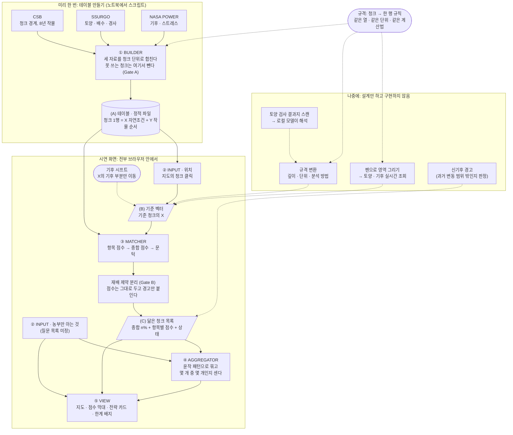

# Field Shift 아키텍처

Field Shift 작업 기준 문서. 백엔드 없이 프론트와 미리 만든 테이블 파일로 가고, 배포는 GitHub Pages에 데이터셋을 같이 올린다.

## 용어

| 용어 | 뜻 |
|---|---|
| 청크 | 경계가 있는 밭 하나. 테이블의 한 행 |
| 기준 청크 | 농부가 클릭한 청크 |
| 닮은 청크 | 기준 청크와 닮았다고 판정된 청크 |
| 테이블 | 미리 만들어 두는 데이터. 청크 하나가 한 행, 열은 자연조건(X)과 8년 작물 순서(Y) |
| 기후 칸 | NASA POWER 격자 한 칸(0.5°×0.625°, 약 50 km). 칸 안의 청크는 기후 값이 같다 |

## 그림

실선은 시연에서 실제로 도는 경로, 점선은 값을 바꾸거나 나중에 붙일 경로다.

## 블록

| 블록 | 하는 일 |
|---|---|
| ① BUILDER | 세 자료를 청크 단위로 합쳐 테이블을 만든다. 해상도 맞추기와 규격 통일이 여기서 끝난다 |
| ② INPUT · 위치 | 농부가 청크를 클릭하면 테이블에서 그 행을 꺼내 기준 벡터로 쓴다 |
| ② INPUT · 농부만 아는 것 | 자료에 없는 것만 묻는다 |
| ③ MATCHER | 기준 벡터와 테이블의 각 행을 비교한다 |
| Gate B | 닮음 점수는 그대로 두고, 그대로 따라 하기 어려운 차이에 경고를 붙인다 |
| ④ AGGREGATOR | 닮은 청크들의 작물 순서를 집계하고, 농부의 현재 윤작과 나란히 놓는다 |
| ⑤ VIEW | 결과를 화면에 그린다 |

## 블록 사이를 오가는 데이터

- (A) 테이블: 청크 한 행에 X(토양·지형·기후 숫자)와 Y(8년 작물 순서)가 들어 있다. X와 Y를 섞지 않는다. Y는 닮음을 재는 데 쓰지 않는다.
- (B) 기준 벡터: 테이블의 X 부분과 같은 모양의 한 행. 기후 시프트는 이 행의 기후 칸만 고치는 것이라서 ③은 모드를 몰라도 된다.
- (C) 닮은 청크 목록: 청크 번호, 종합 점수, 항목별 점수, 상태. ④와 ⑤가 둘 다 받는다.

## 입력

- 농부 입력은 청크 클릭으로 받는다. 토양·기후 숫자는 농부에게 묻지 않고 테이블에서 꺼낸다.
- 농부가 모래·점토 비율이나 평년 기온 같은 숫자는 대부분 모른다. 그래서 숫자는 전부 같은 자료에서 같은 방법으로 나오고, 농부 청크와 비교 대상 청크의 규격이 처음부터 같다.
- 농부에게는 자료에 없고 농부만 아는 것을 묻는다. 후보는 현재 윤작 확인, 물을 대는지, 우선순위.
- 물을 대는지는 닮은 청크 쪽 관개 자료가 없으면 화면을 바꾸지 못한다. 받는다면 예·아니오·모름 선택지로 받고 카드의 안내 문구만 바꾼다.

## 유사도 정의

### 순서

1. **Gate A (비교 가능성)**: 흙이 아닌 땅·도시가 30%를 넘는 청크, 값이 너무 많이 빈 청크를 뺀다. 테이블을 만들 때 적용한다.
2. **닮음 점수**: 자연조건 전체로 잰다. 배수 등급과 산도도 점수 안에 들어간다.
3. **닮은 청크 고르기**: 기준 청크 자신과 빈 패턴 청크(8년 중 2번 이상 나온 작물이 없는 청크)는 후보가 아니다. 종합 점수가 문턱(초기값 80) 이상이고 토양 점수가 65 이상인 후보를 점수순으로 줄 세우고, 기후 칸마다 10개까지만 남긴 뒤, 위에서부터 K개(초기값 30)를 고른다. 동점은 청크 번호의 유니코드 문자 코드 순서.
4. **Gate B (재배 제약 분리)**: 배수 2단계 이상 차이, 산도 차이 1.0 초과, 침수·암반·염류 차이, 물을 대는지 여부.
5. **윤작 집계**: 고른 닮은 청크들의 2018~2025 작물 순서를 묶어 센다. 목록과 카드는 같은 청크 집합이라 목록 수가 곧 카드 분모다. 청크 수 비율과 면적 비중을 같이 적는다. 패턴 동점은 개수 → 면적 → 패턴 이름의 문자 코드 순서.

### 변수와 가중치

"50%가 되는 차이"는 두 청크의 값이 그만큼 다르면 그 항목 점수가 50점이 된다는 뜻이다. 가중치 합은 1.00이다.

| 영역 | 변수 | 가중치 | 50%가 되는 차이 / 규칙 | 출처 |
|---|---|---|---|---|
| 토양 물성·배수 (0.35) | 토성: 0~30 cm 모래·미사·점토 | 0.15 | 거리 = (모래 차 + 미사 차 + 점토 차) / 200. 이 거리가 0.22(22%p 이동)면 50점. 세 성분을 따로 세지 않고 거리 하나로 묶어 중복 가중을 막는다 | SSURGO |
| | 유효수분저장량 0~100 cm | 0.10 | 50 mm | SSURGO |
| | 배수 등급·침수 빈도 | 0.10 | 등급 차 0단계 100점, 1단계 75, 2단계 35, 3단계 이상 10. 침수 빈도가 다르면 25점 감점 | SSURGO |
| 토양 화학·토심·지형 (0.20) | 표층 산도 0~30 cm | 0.06 | 0.90 | SSURGO |
| | 표층 유기물 | 0.03 | 2.2% | SSURGO |
| | CEC | 0.03 | 9.0 | SSURGO |
| | 암반 깊이·염류 | 0.02 | 암반은 150 cm 기준 선형(공백은 200 cm 이상으로 봄), 염류는 2.0 dS/m | SSURGO |
| | 경사 | 0.06 | 선형: `max(0, 1 − 경사 차 / 10)`. 10%p 이상 차이면 0점. 완만한 경사끼리 과하게 깎이지 않게 한 것 | SSURGO |
| 계절 기후 (0.30) | 월별 기온 2001~2025, 4~9월 2배 | 0.10 | 2.8℃ | NASA POWER |
| | 월별 강수 2001~2025, 4~9월 2배 | 0.10 | 30 mm/월 | NASA POWER |
| | 무상기간 2018~2025 | 0.05 | 28일 | NASA POWER |
| | 생육도일(기준 10℃) 2018~2025 | 0.05 | 450 | NASA POWER |
| 수분·극한 스트레스 (0.15) | 여름(6~8월) 뿌리층 수분 | 0.05 | 0.14 | NASA POWER |
| | 폭염일수(최고 32℃ 이상) | 0.05 | 20일/년 | NASA POWER |
| | 가뭄 해 빈도(4~9월 강수가 평년의 80% 미만) | 0.05 | 0.25 | NASA POWER |

- 항목 점수 식: `s = 100 × exp(−ln2 × (차이 / 50%가 되는 차이)²)`. 배수, 경사, 토성은 위 표의 별도 규칙.
- 종합 점수: 가중치 × 항목 점수의 합.
- 감점 기여: 항목마다 `가중치 × (100 − 항목 점수)`. 상세 화면에서 어느 항목이 몇 점을 깎았는지 보여 준다.
- 가중치, 50%가 되는 차이, 문턱 80은 검증된 값이 아니라 초기 실험값이다.
- 뿌리층 수분은 약 50 km 칸의 배경 지표로만 읽는다. 청크의 배수 근거로 쓰지 않는다.

### 경계 비교

- 문턱·경계 비교(τ, 시프트 기후 게이트, 상태 판정, 재배 제약 경고)는 비교할 값을 소수 9자리에서 반올림한 뒤에 한다. 계산 경로에 따라 생기는 부동소수점 꼬리 때문에 판정이 갈리지 않게 하려는 것이다. 예: pH 7.3과 8.3의 차이는 1.0이라 "1.0 초과" 경고가 없다.

### 배수·침수 등급

- 테이블에는 청크 안 토양 구역들의 등급을 면적 가중 평균한 실수로 저장한다(배수 1~7, 침수 0~5).
- 점수와 경고를 계산할 때는 반올림(0.5는 올림)해서 정수 등급으로 분류한 뒤 쓴다. 예: 4.5 → 5, 4.49 → 4.

### 상태 판정

| 상태 | 조건 |
|---|---|
| 핵심 닮은 청크 | 종합 점수가 문턱 이상, 토양 점수 65 이상, Gate B 경고 없음 |
| 환경은 닮았지만 재배 제약 있음 | 종합 점수가 문턱 이상, 토양 점수 65 이상, Gate B 조건에 걸림 |
| 기후만 닮음 | 기후 쪽 점수 80 이상, 토양 쪽 점수 65 미만 (종합 점수와 무관) |
| 테이블 안에 닮은 청크 없음 | 문턱을 넘는 청크가 0개 |
| 신기후 가능성 (나중에) | 옮긴 기후가 과거 변동 범위를 벗어날 때만. 0개라는 이유만으로 신기후라고 하지 않는다 |

### 기후 시프트

- 토양·지형은 그대로 두고 기후·스트레스 값만 옮긴 뒤 같은 식으로 다시 찾는다.
- 시험값: 기온 +2.2℃, 4~9월 강수 −15%, 폭염일 +18일.

### 값이 빈 항목

- 빈 항목을 빼고 남은 항목으로 다시 100점을 만들지 않는다.
- 관측된 가중치 합 C가 0.90 미만이면 비교하지 않고, 0.90 이상이면 점수를 구간(최저~최고)으로 보여 준다. 최저 = 관측된 항목의 점수 합, 최고 = 최저 + 100 × (1 − C).
- 테이블을 만들 때 값이 빈 청크를 미리 빼면 화면에서 구간 표시가 필요 없다. 둘 중 어느 쪽으로 갈지는 미정.

## 표시 원칙

- 닮음 점수나 관측 비율을 성공 확률처럼 말하지 않는다. 분자와 분모를 같이 적는다.
- 수확량, 수익, 병해충, 판로, 농기계 제약은 자료가 없으니 추정하지 않고 "현지 확인 필요"로 표시한다.
- 물을 대는지는 닮음 점수에 넣지 않는다.
- 항목마다 값의 해상도(토양 구역인지 50 km 기후 칸인지)를 밝힌다.
- 가중치와 문턱이 실험값이라는 점을 발표에서 숨기지 않는다.
- 윤작 다양화가 언제나 수확량을 높인다고 말하지 않는다.

## 데이터 소스 사실

- SSURGO 토양 API(SDA)는 로그인 없이 쓰고, 질의당 약 1초, 브라우저 직접 호출(CORS)을 허용한다. 44 ha 사각형 하나에 토양 구역 15개·85줄이 돌아왔다.
- SDA는 도형과 토양 구역의 교차 면적을 서버에서 계산해 준다. 도시에 붙은 땅은 도시·절벽 구역이 25~50% 섞였다. Gate A의 30% 기준이 여기서 나왔다.
- SSURGO 값은 토양 종류 비율 × 0~30 cm 층 두께로 가중평균해야 한다. `aws0100wta`는 cm 단위라 ×10 해서 mm로 쓴다. 암반 깊이 공백은 오류가 아니라 제한층 없음이다.
- NASA POWER는 로그인 없이 쓴다. 일별 조회 한 번(2001~2025)으로 월 평균, 서리일, 생육도일, 폭염일, 가뭄 해 빈도, 뿌리층 수분을 다 만들 수 있다. `PRECTOTCORR`은 mm/day라 일수를 곱해 월 합계를 만든다. 결측값은 -999.
- POWER를 브라우저에서 직접 부를 수 있는지는 확인하지 않았다.
- 데이터 테스트 (2026-11-15 새벽, Claude 실측):
  - POWER 기후 칸: 칸 중심이 위도 0.5°, 경도 0.625°의 배수이고 경계는 그 ±반 칸이다(위도 41.75~42.25, 경도 −94.0625~−93.4375가 한 칸). 칸 안에서는 값이 완전히 같다. 칸 번호 = (round(위도/0.5), round(경도/0.625)).
  - POWER 25년 일별 조회(변수 5개): 한 번에 약 2초, 0.7 MB, 결측 없음.
  - SSURGO 조회(겹치는 구역 + 토양 종류 + 0~30 cm 층을 한 질의로): 한 번에 약 1초. 동시 4개면 청크당 0.23초, 동시 8개면 0.13초, 오류 없음.
  - CSB 2018~2025: NASS가 전국 파일 하나(`NationalCSB_2018-2025_rev23.zip`, 3.76 GB)로만 준다. 안은 File Geodatabase(`CSB1825.gdb`, 주 테이블 5.27 GB)라 GDAL 계열 도구로 읽어야 한다. 이 노트북에서 받는 속도는 약 3.8 MB/s(약 17분).
  - CSB 스키마 실측 (2026-11-15 새벽, Antigravity 확인): `해커톤/NationalCSB_2018-2025_rev23.zip` 다운로드 완료 후 `uv` 가상환경의 `pyogrio`(내장 OpenFileGDB 드라이버)로 조회 확인. 레이어는 `national1825`(`MultiPolygon`, 총 15,973,095개 청크), 좌표계는 NAD83 Albers Equal Area(`EPSG:5070` 계열, 단위 m). 열은 `CSBID`, `CSBYEARS`, `CSBACRES`, `CDL2018`~`CDL2025`(`int32`), `STATEFIPS`, `STATEASD`, `ASD`, `CNTY`, `CNTYFIPS`, `INSIDE_X`, `INSIDE_Y`, `ORIG_FID`, `Shape_Length`, `Shape_Area`.
- 작물 값을 지점으로 묻는 실시간 API(GetCDLValue)는 타임아웃이 난다. 작물 이력은 CSB 파일을 받아서 써야 한다.
- CSB 2018~2025판은 2026-03-27 공개. 경계는 위성 분류로 만든 것이라 소유권 경계가 아니고, 작물도 위성 분류라 틀릴 수 있다.
- 비상업 라이선스 자료(POLARIS, STaPL)는 쓰지 않는다. 결과물과 외부 자료는 공개·오픈소스여야 한다는 대회 약관에 안 맞는다.

## 샘플링 기준 (1차 실데이터 테이블)

- **사전 제외**: 너무 작은 조각(`CSBACRES < 10` 에이커)과 비농지·초지·휴경을 빼고 실제 재배 작물이 8년 중 2번 이상 나오지 않는 빈 패턴 청크는 CSB 추출 단계에서 먼저 뺀다.
- **본토 층화 추출**: 미국 본토 전역(중서부뿐 아니라 시프트 모드 매칭 대상인 남부·대평원 고온·건조 지역 포함)에서 농경지가 있는 기후 칸 약 250~300개를 고르게 선택하고, 칸마다 8~10개 청크씩 총 2,000~2,500개를 뽑는다(Gate A 탈락분을 감안해 여유 있게 뽑아 최종 약 2,000개 확보).
- **원천 분리 저장**: 추출한 CSB 표본, NASA POWER 칸별 일별 응답, SSURGO 청크별 응답은 원천 파일로 따로 저장해 두고, 계산 기준이 바뀌면 API 재호출 없이 빌더만 다시 돌린다.

## 테이블 값 검사

계산 전에 테이블을 검사하고, 어긋난 값이 있으면 계산하지 않고 어느 청크의 어느 열이 왜 틀렸는지 알린다.

- 열 84개가 전부 있다. 숫자 열은 유한한 숫자다(빈 값, NaN, 무한대, POWER 결측값 -999 금지).
- `chunk_id`는 겹치지 않는다. `crops.json`이 있어야 한다.
- 토성: 모래 + 미사 + 점토 = 100 (±0.5).
- 범위: 배수 1~7, 침수 0~5, 암반 0 초과 200 이하, pH 3~11, 유기물·CEC·염류·경사·유효수분·강수·면적 0 이상, 뿌리층 수분·가뭄 해 빈도 0~1, 무상기간·폭염일수 0~366.
- 작물 코드는 정수다.

## 데이터 준비 단계

### A. 원천에서 한 번 받아 두면 끝 (외부 조회)

원천 응답을 그대로 저장해 둔다. 아래 B의 기준이 바뀌어도 다시 받지 않는다.

| 원천 | 단위 | 받아 둘 것 |
|---|---|---|
| CSB | 청크 | 청크 경계, 중심 좌표, 면적, 2018~2025 작물 코드 |
| SSURGO (SDA) | 청크 | 청크 경계와 겹치는 토양 구역·면적, 토양 종류 비율, 깊이별 층 값(모래·미사·점토, 유기물, pH, CEC, 염류), 유효수분, 배수 등급, 침수 빈도, 경사, 암반 깊이 |
| NASA POWER | 기후 칸 | 2001~2025 일별 T2M, T2M_MAX, T2M_MIN, PRECTOTCORR, GWETROOT |
| CDL 코드표 | 전체 | 작물 코드 → 이름 (`crops.json`) |
| (선택) SMAP | 기후 칸 | 뿌리층 토양 수분 |

### B. 받아 둔 것에서 계산만 (빌더, 기준이 바뀌면 다시 계산)

| 결과 | 단위 | 계산에 들어가는 기준 |
|---|---|---|
| 토양 값 12개 | 청크 | 0~30 cm 두께 가중, 토양 종류 비율 × 면적 가중, 유효수분 cm → mm, 암반 공백 → 200 |
| 흙이 아닌 땅 비율 (Gate A) | 청크 | 30% 초과면 제외 |
| 월별 기온·강수 | 기후 칸 | 평균 기간 |
| 무상기간, 생육도일, 폭염일수, 여름 뿌리층 수분, 가뭄 해 빈도 | 기후 칸 | 기간, 32℃, 10℃, 6~8월, 평년의 80% |
| 시프트 후 기후 값 | 기후 칸 | 시프트 시나리오(+2.2℃ 등)를 일별 값에 더해 다시 계산 |
| 패턴 키 | 청크 | 2번 이상 |
| 파일 나누기 (위치, 토양, 기후, 상세) | | 지역 분할 크기 |
| 값 검사 | | "테이블 값 검사" 규칙 |

### C. 화면에서 매번 계산 (저장하지 않음)

배수·침수 등급 분류, 항목 점수, 종합·블록 점수, 경고, 상태, 거리 조건, 고르기(문턱, 토양 65, 시프트 게이트, 칸 상한, 상위 K), 윤작 집계.

## 지도와 후보 범위

- 지도는 미국 본토 안으로 제한한다.
- 기준 청크를 고르기 전에는 지금 화면에 보이는 범위의 청크만 보여 준다.
- 기준 청크를 고른 뒤에는 기준 청크에서 일정 거리 이상 떨어진 청크만 후보로 삼는다. 농부가 바로 옆 밭은 이미 알고 있어서다. 거리 값은 미정.
- 그래서 테이블은 본토 전체에 걸쳐 뽑아야 한다.

## 미정

- 후보 최소 거리. Claude 제안: 100 km. 기후 칸 대각선이 위도에 따라 72~84 km라서, 100 km면 같은 기후 칸 청크(기후 점수가 공짜로 100)가 본토 어디서나 빠진다.
- NASA 자료를 어디까지 쓸지 (POWER만 / 위성 식생지수 추가 / SRTM·SMAP까지). 지금 구성은 POWER 하나다.
- 농부에게 추가로 물을 것
- 화면에 보여 줄 것. "현재 윤작 포함 3개 전략 비교"를 카드로 넣을지 포함
- 지도가 청크를 점으로 들고 있을지 경계로 들고 있을지
- 테이블 파일을 하나로 할지, 계산용과 경계 도형으로 나눌지
- 월별 기온·강수 12개 달의 차이를 한 점수로 합치는 방법
- 윤작 패턴을 묶는 방법. 같은 윤작도 시작 해가 다르면 순서가 달라 보이고, 위성 분류 오류로 같은 윤작이 여러 패턴으로 쪼개진다
- 가뭄 해 빈도를 8년(2018~2025)으로 세는 것이 충분한지

## 범위 밖

- 전체 청크를 미리 겹치지 않는 그룹으로 나누는 군집화. 기준 청크 하나를 중심으로 찾는 방식에는 필요 없다.
- Random Forest, Mahalanobis, 공간 교차검증, 가중치 민감도 분석
- 농부 입력을 쌓아 가는 구조
- 수확량, 수익, 병해충 예측

## 나중에 (설계만)

- 펜으로 영역 그리기: 그린 도형으로 토양·기후를 실시간 조회해 기준 벡터를 만든다. ②만 바뀌고 ③④⑤는 그대로다.
- 토양 검사 결과지 스캔: 결과지 양식이 검사소마다 달라서 로컬 모델이 읽는다. 읽은 값은 깊이·단위·분석 방법이 테이블의 정의와 달라서 규격 변환을 거쳐야 기준 벡터에 들어간다. 발표에서는 "설계는 했으나 구현 못했다"로 밝힌다.
- 신기후 경고: 옮긴 기후가 과거에 있던 범위 밖인지 따로 판정한다.

## 만드는 순서

1. 가짜 청크 10행짜리 파일로 ②~⑤ 화면 흐름을 끝까지 만든다.
2. 그동안 ① BUILDER 스크립트로 진짜 테이블을 만든다.
3. 파일만 진짜로 바꿔 끼운다.

테이블의 열 이름을 먼저 정하면 1번과 2번을 동시에 할 수 있다.

## 관련

- [[PROJECT_SPEC]]
- [[Field Shift 챌린지 공식 정보]]
- [[Space Apps Field Shift 챌린지]]
